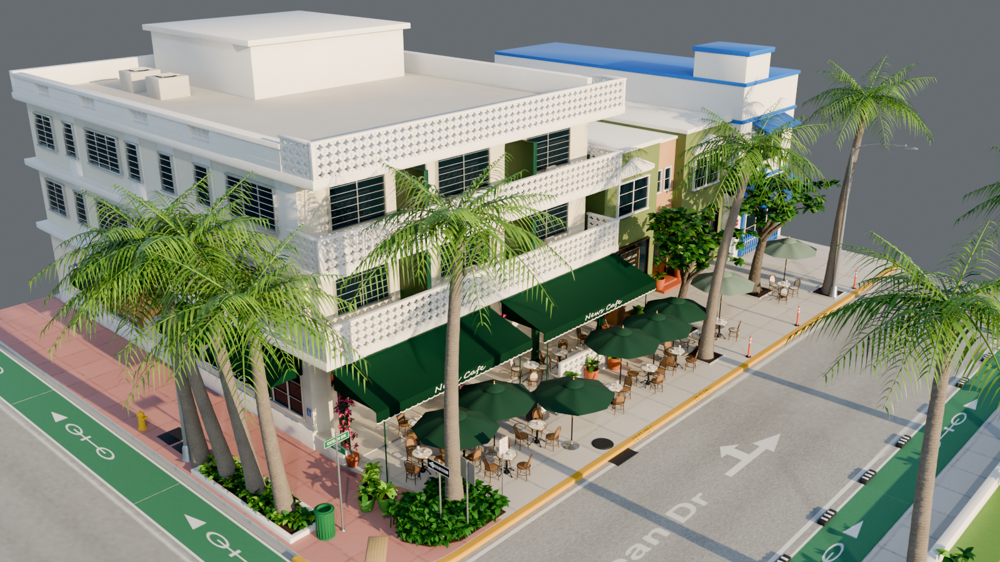
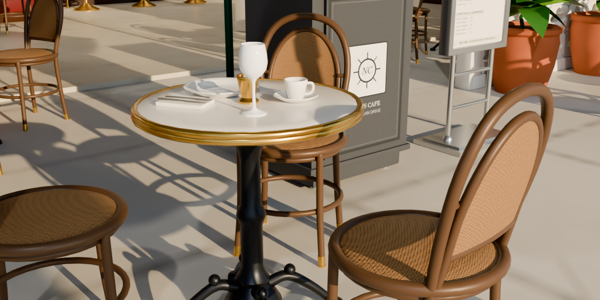

<div align="center">
  
  <h1>Velum Forge</h1>
  <p><strong>AI-Driven Precision B-Rep CAD, Blender 5.2+ Cycles GPU PBR Baking, 4-Tier LOD &amp; Game Asset Studio</strong></p>
  <p>
    <a href="LICENSE"></a>
    
    
    
  </p>
</div>

---

**Velum Forge** turns AI coding agents (**Google Antigravity**, **Claude Code CLI**, **Codex**, **Cursor**) into deterministic, studio-grade 3D asset engineers. Instead of fragile primitive kitbashing or un-exportable procedural shaders, Velum Forge enforces a **6-Gate Production Pipeline** combining OpenCascade B-Rep CAD (`build123d`), closed `S^2` `bmesh` surfacing, hard `BVHTree` shell-clipping gates, 10-view automated visual QA, `2048x2048` Cycles `OPTIX` GPU PBR texture baking, multi-variant generation, and seam-locked `LOD0`–`LOD3` chains.

## Showcase — Built 100% Programmatically with Velum Forge

### 1. Hard-Surface & Naval Architecture (`examples/sunrunner_24`)
*24-ft Offshore Center-Console Sportfisher — `build123d` CAD helm/cleats/prop + parametric Carolina-flare hull + `0` BVH shell breaches + `2048x2048` Cycles-baked Burmese teak, diamond non-skid & sonar UI + 4 showroom/patrol variants + `LOD0`–`LOD3` (`97.2k -> 13.0k` tris).*

| 4 Baked Showroom & Roleplay Variants | Macro Close-Up (`2048x2048` Baked Teak & Non-Skid) |
| :---: | :---: |
|  |  |

### 2. Organic Wildlife & Pelagic Anatomy (`examples/mahi_mahi`)
*Offshore Trophy Mahi-Mahi (`Coryphaena hippurus`, `1.20 m` LOA) — Closed `S^2` watertight manifolds + Bull/Cow cranial sexual dimorphism + `2048x2048` baked imbricated diamond scales, wet mucus roughness & gill operculum + 4 rarity tiers + 7-bone swim rig + `LOD0`–`LOD3` (`40.1k -> 4.5k` tris).*

| 4 Bull/Cow Rarity Variants | Macro Scales & Gill Operculum (`2048x2048` Bake) |
| :---: | :---: |
|  |  |

### 3. Architectural Landmarks, Interiors & Streetscapes (`examples/news_cafe_south_beach`)
*News Cafe South Beach (800 Ocean Dr, Miami Beach) — Streamline Moderne facade & open-work breeze blocks + 3D interior bar, mitered framed art & channel-tufted banquettes + structured quad-flow bistro furniture & tableware (`81.6%–86.2%` `Alt+J` quad recovery) + 3D curved palms/sea-grapes/bougainvillea + modular linked instancing + 19 dedicated `2048x2048` Cycles PBR sets + instance-aware `LOD0`–`LOD3` (`--profile game`).*

| Ocean Drive Street-Level Hero Render | Macro Bistro Set & Joint-Lock Detail (`2048x2048` Bake) |
| :---: | :---: |
|  |  |

---

## Quick Start & 1-Click Installer

### Windows (Zero-Prerequisite PowerShell 1-Liner or Native Setup Wizard)
> **No Python, `uv`, or Git on `PATH`? No problem.** `install.ps1` and `Setup-VelumForge.cmd` automatically bootstrap standalone `uv` + portable CPython 3.12 (rejecting broken Windows Store stubs) and deep-scan all drives (`C:`–`Z:`), **Steam libraries (`libraryfolders.vdf`)**, **Blender Launcher**, **Windows Registry (`.blend` file associations, `Uninstall` keys, `MuiCache`)**, **Scoop/Chocolatey**, and **Microsoft Store** to find `blender.exe` automatically.

```powershell
# Clone (or HTTPS zip fallback) + auto-bootstrap Python 3.12 .venv + detect Blender + install AI skills:
irm https://raw.githubusercontent.com/velumix/velum-forge/main/install.ps1 | iex
```
Or after cloning/downloading locally:
- Double-click **`Setup-VelumForge.cmd`** to open the zero-dependency native Windows `.NET` Setup Wizard (includes a **Browse...** picker if Blender lives on an external drive).
- Double-click **`Launch-VelumForge-Studio.cmd`** (or run `vforge studio`) to launch the **Velum Forge Studio** desktop app.
- Need to point to a custom portable Blender manually? Click **`Locate blender.exe...`** in Studio's Environment Doctor tab or run:
  ```powershell
  vforge set-blender "D:\CustomTools\Blender 5.2\blender.exe"
  ```

### macOS / Linux
```bash
git clone https://github.com/velumix/velum-forge.git
cd velum-forge && chmod +x install.sh && ./install.sh
vforge studio
```

---

## Generating Your First 3D Model (Perspective Photos, Blueprints & Optional Rating Reviews!)

### In the Desktop Studio App (`vforge studio`)
1. Open **Velum Forge Studio** (`Launch-VelumForge-Studio.cmd` or `vforge studio`) — it opens directly to **`+ Generate 3D Asset`**.
2. **Step 1:** Enter a name (e.g. `800 Ocean Dr News Cafe` or `Red Snapper`), pick an archetype (`Fish / Creature`, `Architecture / Street Scene`, `Boat / Vehicle`, `Mechanical CAD`, or `Prop`), set real-world meters, and describe your model.
3. **Step 2 (Perspective-First References):** **Drag & drop** multiple photos/Street Views/blueprints (or press **`Ctrl+V`**).
   - **Real perspective photos** (`Hero 3/4`, `Street View`, `Close-Up`, `Aerial`) automatically spawn **matched Blender Perspective Cameras (`VF_RefCam_*`)** with real focal lengths (`24mm`–`85mm`) and camera background overlays — producing a **multi-angle side-by-side `ref_comparison.png`** without forcing ortho grids onto perspective shots!
   - **Orthographic blueprints** (`Ortho Side / Front / Back / Top`) place `1:1 m` orthographic planes and unlock the **opt-in Metric Blueprint Grid** strictly on ortho views.
4. **Optional Core Feature — Iterative Critic (Always Strict 10/10) & High-Poly Uncapped Toggle:** Toggle **`Enable Iterative Visual Critic & Honest Rating Loop`** ON whenever you want multi-pass refinement (always iterates until genuinely **`10.0 / 10`** with `0` QA errors/warnings and `0` unresolved defects — never stops below `10/10`). Optionally toggle **`High-Poly Photorealistic Mode`** ON to inject uncapped `--high-poly --max-tris 0` geometry floors without forcing it globally. Leave both OFF for instant single-pass builds.
5. **Step 3 — Pick how to build:**
   - **Generate 3D Asset Now (Instant + Ref QA):** Builds a reference-calibrated multi-part `.blend` + `.glb`, renders the 10-view QA sheets + **Multi-Angle Reference vs. Model (`ref_comparison.png`)**, and generates 4 variants + `LOD0`–`LOD3`!
   - **Generate Bespoke via Local AI CLI (`Claude` / `Codex` / `Gemini`):** Drives your installed multimodal AI CLI directly against `references/*` and `asset_spec.json`.
   - **Stage & Copy Prompt for Antigravity / Cursor:** Stages `references/` + `asset_spec.json` and copies a ready-to-paste prompt to your clipboard (including matched perspective camera instructions and optional Honest Rating loop commands).

### From the Command Line (`vforge`)
```powershell
# Generate a new 3D asset with opt-in Iterative Strict 10/10 Review + opt-in High-Poly Uncapped Mode:
vforge generate ocean_dr_800 --kind building --length 18.0 --ref gsv_front.jpg --ref gsv_corner.jpg --iterate
vforge generate ocean_dr_800 --kind building --length 18.0 --ref gsv_front.jpg --high-poly --rate-to-10 --engine handoff

# Toggle Optional Iterative Review (always 10.0/10 target) or High-Poly Uncapped Mode on any existing asset:
vforge review config examples\mahi_mahi --enable --high-poly
vforge review log examples\mahi_mahi --score 7.8 --summary "Strong glazing & silhouette, minor foliage fixes left" --strength "100% outward blue normals" --defect "Botanicals|major|Straight branch cylinders|Replace with curved branching canopy"
vforge review status examples\mahi_mahi      # Score trajectory + reviews/iteration_progression.png
vforge review prompt examples\mahi_mahi      # Focused Next-Iteration defect-fix prompt

# Architectural QA (default 300k BVH guard, or --high-poly --max-tris 0 for opt-in uncapped mode):
vforge qa examples\news_cafe_south_beach\build_news_cafe_south_beach.py --profile game --high-poly --max-tris 0 --forward-axis +Y

# Attach perspective photos (or ortho blueprints) & run QA with multi-ref side-by-side comparison:
vforge add-ref examples\mahi_mahi C:\photos\dorado_ref.jpg --view hero --lens 50
vforge qa examples\mahi_mahi\build_mahi_mahi.py --forward-axis +Y --snapshot-iteration

# Use --ortho-grid ONLY when verifying flat orthographic blueprints:
vforge qa path\to\build_blueprint_asset.py --forward-axis +Y --ortho-grid

# Other core commands:
vforge new building corner_bistro                                 # Scaffold building | arch | boat | fish | prop | cad
vforge doctor                                                     # Verify Blender 5.2+/5.3, CAD venv & AI skills
vforge install-ai --workspace C:\path\to\your\game                # Sync Antigravity, Claude & Cursor skills/rules
vforge bake examples\mahi_mahi\bake_lod_variants.py               # Hardware-safe GPU-only 2K PBR + variants + LOD0-LOD3
# Optional safe bake overrides (safe GPU-only, GPU denoiser, thread cap & sequential GPU lock are automatic):
# vforge bake <script.py> [--threads 8] [--device auto|gpu|optix|cuda|cpu] [--cooldown 1.0] [--tile-size 512] [--no-lock] [--user-addons]
vforge studio                                                     # Launch Velum Forge Studio desktop app
```

---

## AI Agent Skills & Documentation (Antigravity, Claude Code, Codex, Cursor)

Running `install.ps1` or `vforge install-ai` automatically installs:
1. **Google Antigravity Plugin** (`~/.gemini/config/plugins/velum-forge`) with always-on `rules/AGENTS.md` and 5 progressive-disclosure skills:
   - [`velum-3d-workflow`](plugins/velum-forge/skills/velum-3d-workflow/SKILL.md) — Master 6-Gate 3D production runbook (`--profile roblox` vs `--profile game`, quad-flow, modular instancing & optional Iterative Honest Rating Loop).
   - [`velum-architecture-environments`](plugins/velum-forge/skills/velum-architecture-environments/SKILL.md) — Landmarks, restaurants, interiors, hospitality furniture, streetscapes, 2D/Dual-UV signage & 3D botanicals.
   - [`velum-cad-brep`](plugins/velum-forge/skills/velum-cad-brep/SKILL.md) — Precision `build123d` OpenCascade mechanical hardware (`STEP` + `1:1 m` `GLB`) and B-Rep vs. quad-flow routing.
   - [`velum-pbr-bake-lods`](plugins/velum-forge/skills/velum-pbr-bake-lods/SKILL.md) — Cycles `OPTIX` `2048x2048` dedicated per-set PBR baking, `isolate_for_ao`, UV clamp-before-nudge & instance-aware `LOD0`–`LOD3`.
   - [`velum-organic-species`](plugins/velum-forge/skills/velum-organic-species/SKILL.md) — Closed `S^2` organic/creature manifolds, signed-volume outward normals, polar jewel eyes & analytical swim rigs.
2. **Claude Code CLI Skills** (`~/.claude/skills/velum-*`) + root [`CLAUDE.md`](CLAUDE.md).
3. **Universal Agent Docs** — [`AGENTS.md`](AGENTS.md), [`docs/AI_AGENT_PLAYBOOK.md`](docs/AI_AGENT_PLAYBOOK.md), [`docs/BLENDER_52_GOTCHAS.md`](docs/BLENDER_52_GOTCHAS.md), and [`docs/ARCHITECTURE.md`](docs/ARCHITECTURE.md).

---

## License
MIT &copy; [Velumix](https://github.com/velumix)
