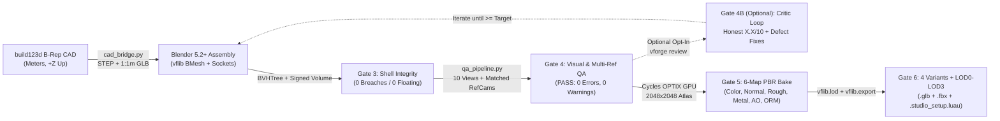

# Velum Forge — System Architecture & Coordinate Conventions

## 1. End-to-End Pipeline Dataflow

## 2. Coordinate & Scale Standards

| Stage / Target | Length Unit | Forward Axis | Right Axis | Up Axis | Notes |
| :--- | :---: | :---: | :---: | :---: | :--- |
| **`build123d` CAD** | `1.0 = 1 m` | `+Y` | `+X` | `+Z` | `cad_bridge.py` applies `R_ZUP_TO_GLTF` once on GLB export so Blender imports at `1:1 m` `Z-up`. |
| **Blender (`vflib`)** | `1.0 = 1 m` | `+Y` | `+X` | `+Z` | Lowest resting vertex shifted to `Z = 0.0000 m`; object scale `(1, 1, 1)`. |
| **glTF / GLB 2.0** | `1.0 = 1 m` | `+Z` / `-Z` | `+X` | `+Y` | Handled automatically by Blender's glTF 2.0 exporter (`export_apply=True`). |
| **Roblox (`vflib.export`)** | `3.0 studs / m` | `-Z` (`LookVector`) | `+X` | `+Y` | `scale_mesh` bakes `3.0 studs/m` (`1.8 m` human = `5.4 studs` R15) and generates `.studio_setup.luau`. |

## 3. Repository Layout

- **`velum_forge/`** — Python CLI (`vforge`), Environment Doctor (`doctor.py`), Asset Scaffolder (`scaffold.py`), Hardware-Safe Bake Guard (`bake_guard.py`), Optional Review Loop (`review.py`), Tkinter Setup Wizard (`installer_gui.py`), and Desktop Studio App (`studio_server.py` + `ui/index.html`).
- **`engine/blender/`** — `vflib` (`core`, `geo`, `quadflow`, `mats`, `gameready`, `integrity`, `bake`, `lod`, `export`, `refs`, `render`), `sclib` compatibility shim, `safe_bake_runner.py`, and standalone 10-view `qa_pipeline.py` + `qa_check.py`.
- **`engine/cad/`** — `cad_bridge.py` (`build123d` <-> `trimesh` / `pymeshlab`), `compose_sheet.py`, and `run_qa.ps1`.
- **`plugins/velum-forge/`** — Official Google Antigravity plugin (`plugin.json`, `rules/AGENTS.md`, and 5 `SKILL.md` modules including `velum-architecture-environments`), mirrored to Claude Code (`~/.claude/skills`) and Cursor (`.cursor/rules`) by `vforge install-ai`.
- **`examples/`** — Production reference generators (`news_cafe_south_beach` landmark restaurant & Ocean Dr streetscape, `sunrunner_24` offshore center-console boat, `cruiser_boat_7c`, `memorial`, and `mahi_mahi` pelagic trophy gamefish).
